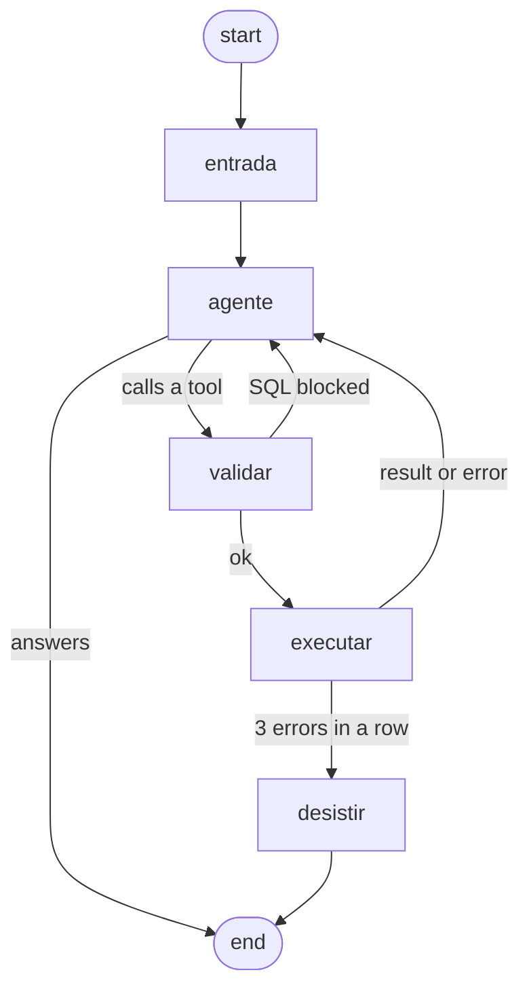

# 💬 Chat With Your Data (text → SQL)

A chat interface with an **AI agent** that already knows the data in the `demo_data/` folder.
Ask a question in plain language ("which category has the highest profit margin?") and the agent **picks the tables, writes the SQL, runs it, shows the table and a chart, and explains the result**.

Built with **Python · LangGraph · DuckDB · Streamlit · Plotly**. Works with any LLM provider (Gemini, Groq, OpenRouter, Ollama).

<!-- Replace with the published demo link and add a GIF/screenshots here -->
> 🔗 **Live demo:** _coming soon_  ·  🎥 **Video:** _coming soon_

## How it works

The agent is a **custom LangGraph graph** (`StateGraph`), not an off-the-shelf agent. Every question flows through nodes with separate responsibilities:



| Node | What it does |
|---|---|
| `entrada` (entry) | Starts a new turn (resets the error counter; conversation memory is kept) |
| `agente` (agent) | The model decides which tool to call, or answers the user |
| `validar` (validate) | **Blocks any SQL that is not a `SELECT`** before it ever touches the database |
| `executar` (execute) | Runs the tools; SQL errors go back to the model, which **self-corrects** (up to 2 retries) |
| `desistir` (give up) | Answers honestly when it can't reach a valid query |

**Agent tools:** `listar_tabelas` (list tables), `descrever_tabela` (describe a table), `executar_sql` (run SQL), `criar_grafico` (create chart).

### Engineering highlights
- 🛡️ **Read-only by design:** allowlist validation (only `SELECT`/`WITH`), one statement at a time, no file access through SQL. Covered by tests.
- 🔁 **Self-correction:** the DuckDB error is fed back to the model, which fixes its own SQL.
- 🧠 **Conversation memory** (LangGraph checkpointer): follow-ups like "and only 2024?" work.
- 👀 **Transparency:** the generated SQL is shown with every answer, and the agent's steps stream live in the UI.
- 📂 **Zero data setup:** every CSV in `demo_data/` becomes a table automatically; the agent figures out on its own how the tables relate.
- 🔌 **Provider-agnostic:** switch models with an environment variable, with automatic fallback models when a free-tier quota runs out.
- 🧪 **Tests without an API key:** the graph is tested with a simulated model.

## Demo data

8 fictional CSVs (with realistic patterns: Black Friday spike, ~15% YoY growth, returns…) in `demo_data/`:
online store (`store_customers`, `store_products`, `store_orders`, `store_order_items`), HR (`hr_employees`),
marketing (`marketing_daily`), support (`support_tickets`) and personal finance (`personal_finance_2025`).

## Questions to try

The agent answers in the language you ask in.

1. How much revenue did the store make in 2025?
2. Show monthly revenue for 2024 and 2025 _(the chart reveals the Black Friday spike)_
3. Which category has the highest profit margin? _(joins 3 tables)_
4. What is the return rate by category?
5. Which department has the highest turnover, and what is the main reason people leave?
6. Which ad channel has the best return (revenue ÷ spend)?
7. How much did I spend on food delivery in 2025?

## Running locally

```bash
# Python 3.10+ (3.12 recommended)
python3.12 -m venv .venv && source .venv/bin/activate
pip install -r requirements.txt
cp .env.example .env        # then add your key (free Gemini key: aistudio.google.com)
streamlit run app.py
```

The `.env` file is loaded automatically.

Tests (no API key needed):

```bash
pip install -r requirements-dev.txt && pytest
```

### Choosing the model

| `LLM_PROVIDER` | Key | Notes |
|---|---|---|
| `gemini` (default) | `GOOGLE_API_KEY` | Free tier from Google AI Studio |
| `groq` | `GROQ_API_KEY` | Very fast |
| `openrouter` | `OPENROUTER_API_KEY` | `:free` models (requires `pip install langchain-openai`) |
| `ollama` | — | Local (requires `pip install langchain-ollama`) |

`LLM_MODEL` overrides the provider's model. With Gemini, the agent automatically falls back to other models when one hits its quota (`LLM_FALLBACK_MODELS` to customize). Free-tier limits change often: check each provider's page.

## Deploying (Streamlit Community Cloud)
1. Push the repo to GitHub (the key **never** goes in the code: `.env` and `secrets.toml` are in `.gitignore`).
2. In Streamlit Community Cloud, create an app pointing to `app.py`.
3. Under **Settings → Secrets**, paste the contents of `.streamlit/secrets.toml.example` with your key.
4. The demo limits each session to **10 questions** (`MAX_QUESTIONS`) to protect the free quota.

## Project structure

```
app.py              # Streamlit UI
agent/
  db.py             # CSVs → DuckDB
  safety.py         # "SELECT only" validation
  tools.py          # the 4 tools + charts
  llm.py            # model factory
  graph.py          # the agent's StateGraph
tests/              # pytest, no API calls
demo_data/          # demo CSVs
```

## Next steps
- A Power BI dashboard on the same data (star schema + DAX), to compare "open the dashboard" vs. "just ask".
- Automated evaluation: a set of questions with expected answers to measure SQL accuracy.
