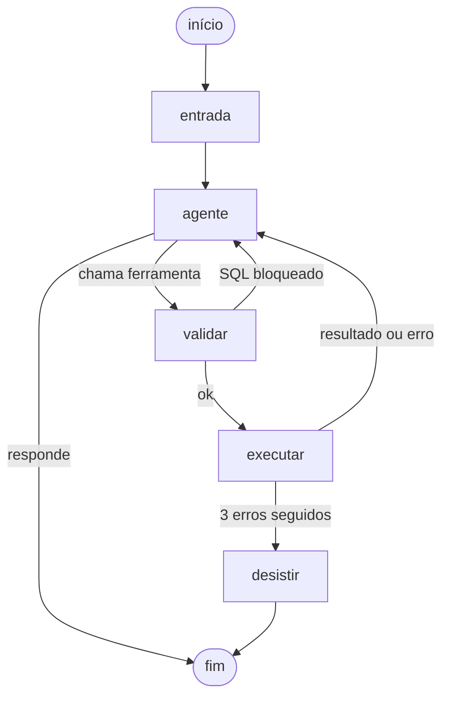

# 💬 Chat com seus dados (texto → SQL)

Uma tela de chat com um **agente de IA** que já conhece os dados da pasta `demo_data/`.
Você pergunta em linguagem normal ("qual categoria tem a maior margem?") e o agente **escolhe as tabelas, escreve o SQL, executa, mostra a tabela e o gráfico, e explica o resultado**.

Feito com **Python · LangGraph · DuckDB · Streamlit · Plotly**. Funciona com qualquer modelo (Gemini, Groq, OpenRouter, Ollama).

<!-- Troque pelo link da demo publicada e coloque aqui o GIF/prints -->
> 🔗 **Demo:** _em breve_  ·  🎥 **Vídeo:** _em breve_

## Como funciona

O agente é um **grafo próprio do LangGraph** (`StateGraph`), não um agente pronto. Cada pergunta passa por nós com responsabilidades separadas:



| Nó | O que faz |
|---|---|
| `entrada` | Começa um novo turno (zera o contador de erros; a memória da conversa continua) |
| `agente` | O modelo decide qual ferramenta usar ou responde ao usuário |
| `validar` | **Barra qualquer SQL que não seja `SELECT`** antes de tocar no banco |
| `executar` | Roda as ferramentas; erros de SQL voltam pro modelo, que **se autocorrige** (até 2 retentativas) |
| `desistir` | Responde com honestidade quando não chega a uma consulta válida |

**Ferramentas do agente:** `listar_tabelas`, `descrever_tabela`, `executar_sql`, `criar_grafico`.

### Destaques de engenharia
- 🛡️ **Somente leitura:** validação por *allowlist* (só `SELECT`/`WITH`), uma instrução por vez, sem leitura de arquivos pelo SQL. Coberta por testes.
- 🔁 **Autocorreção:** o erro do DuckDB volta pro modelo, que corrige o SQL.
- 🧠 **Memória da conversa** (checkpointer do LangGraph): "e só em 2024?" funciona.
- 👀 **Transparência:** o SQL gerado aparece em cada resposta e os passos do agente são mostrados em tempo real (*streaming*).
- 📂 **Zero configuração de dados:** todo CSV na pasta `demo_data/` vira uma tabela automaticamente; o agente descobre sozinho como elas se ligam.
- 🔌 **Independente de provedor:** troca de modelo por variável de ambiente.
- 🧪 **Testes sem chave de API:** o grafo é testado com um modelo simulado.

## Dados de demonstração

8 CSVs fictícios (mas com padrões reais: pico de Black Friday, crescimento ~15% a/a, devoluções…), em `demo_data/`:
loja online (`store_customers`, `store_products`, `store_orders`, `store_order_items`), RH (`hr_employees`),
marketing (`marketing_daily`), suporte (`support_tickets`) e finanças pessoais (`personal_finance_2025`).

## Perguntas para testar

1. Quanto a loja faturou em 2025?
2. Mostre o faturamento por mês em 2024 e 2025 _(gráfico com o pico da Black Friday)_
3. Qual categoria tem a maior margem de lucro? _(junta 3 tabelas)_
4. Qual a taxa de devolução por categoria?
5. Qual departamento tem a maior rotatividade e qual o principal motivo de saída?
6. Qual canal de anúncio tem o melhor retorno (receita ÷ gasto)?
7. Quanto gastei com delivery em 2025?

## Rodando localmente

```bash
# Python 3.10+ (recomendado 3.12)
python3.12 -m venv .venv && source .venv/bin/activate
pip install -r requirements.txt
cp .env.example .env        # e preencha a chave (Gemini grátis: aistudio.google.com)
export $(grep -v '^#' .env | sed 's/ *#.*//' | xargs)
streamlit run app.py
```

Testes (não precisam de chave):

```bash
pip install -r requirements-dev.txt && pytest
```

### Escolhendo o modelo

| `LLM_PROVIDER` | Chave | Observação |
|---|---|---|
| `gemini` (padrão) | `GOOGLE_API_KEY` | Plano gratuito do Google AI Studio |
| `groq` | `GROQ_API_KEY` | Muito rápido |
| `openrouter` | `OPENROUTER_API_KEY` | Modelos `:free` (requer `pip install langchain-openai`) |
| `ollama` | — | Local (requer `pip install langchain-ollama`) |

`LLM_MODEL` troca o modelo do provedor. Limites do plano gratuito mudam: confira na página de cada provedor.

## Publicando (Streamlit Community Cloud)
1. Suba o repositório no GitHub (a chave **nunca** vai no código: `.env` e `secrets.toml` estão no `.gitignore`).
2. No Streamlit Community Cloud, crie o app apontando para `app.py`.
3. Em **Settings → Secrets**, cole o conteúdo de `.streamlit/secrets.toml.example` com a sua chave.
4. A demo limita **10 perguntas por sessão** (`MAX_QUESTIONS`) para não estourar a cota gratuita.

## Estrutura

```
app.py              # interface Streamlit
agent/
  db.py             # CSVs → DuckDB
  safety.py         # validação "só SELECT"
  tools.py          # as 4 ferramentas + gráficos
  llm.py            # fábrica de modelos
  graph.py          # StateGraph do agente
tests/              # pytest, sem chamar API
demo_data/          # CSVs de demonstração
```

## Próximos passos
- Dashboard Power BI com os mesmos dados (modelo estrela + DAX), para comparar "abrir o dashboard" × "só perguntar".
- Avaliação automática: conjunto de perguntas com respostas esperadas para medir a acurácia do SQL.
